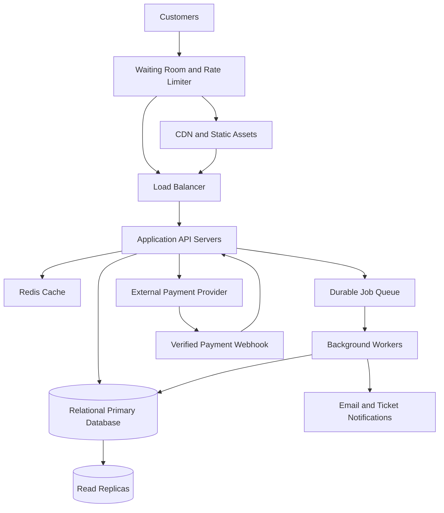

# TicketHub: Event Ticketing System Design

## 1. Requirements

TicketHub is a website where users browse events, select seats, purchase tickets, and view their confirmed bookings.

### Functional requirements

- Users can register, sign in, and manage their accounts.
- Users can browse upcoming events and view event details.
- Users can view the available, held, and sold seats for an event.
- Users can temporarily hold available seats while completing checkout.
- Users can pay for an order and receive confirmation.
- Users can view their purchased tickets and booking details.
- The system can release expired seat holds and recover from failed payments.
- Administrators can create and update events and configure their seat inventory.

### Non-functional requirements

**Performance:** Event listings and ordinary pages should load within approximately two seconds under normal conditions. Seat availability and checkout responses should remain responsive during high-demand sales, with a target of less than two seconds for most requests where practical.

**Correctness:** A seat must not be confirmed for more than one customer. Orders, seat assignments, and payment results must remain consistent even when requests are retried or services fail.

**Fairness:** A waiting-room queue should control access during major sales. Users should receive queue positions or admission tokens, and the system should enforce the same seat-hold duration and purchase rules for everyone. Rate limits and bot detection should reduce automated abuse.

**Availability:** The website should remain usable if an application server or background worker fails. Critical services should have health checks, redundancy, and recovery procedures.

**Security:** Authentication, authorization, HTTPS, payment-provider integration, and restricted access to personal information are required. Payment card details should be handled by a compliant payment provider rather than stored directly by TicketHub.

**Scalability:** Application servers and background workers should scale horizontally to handle sudden increases in traffic.

**Observability:** Logs, metrics, tracing, alerts, and audit records should help identify errors, payment failures, and unusually long queues.

## 2. Traffic and Capacity Estimates

### Given assumptions

- Registered users: 2,000,000
- Normal daily visitors: 50,000
- Pages viewed per visitor per day: 10
- Normal daily ticket sales: 5,000
- Popular concert inventory: 20,000 seats
- People attempting to buy during the first 10 minutes: 200,000

These are planning estimates. Actual traffic can vary, and a popular sale may have a much sharper peak than its ten-minute average.

### Normal-day traffic

**Daily page views**

50,000 visitors × 10 pages = 500,000 page views/day.

**Average page-view rate**

500,000 ÷ 86,400 seconds ≈ 5.8 page views/second.

**Average ticket sales rate**

5,000 ÷ 86,400 seconds ≈ 0.058 tickets/second, or approximately 208 tickets/hour averaged across the day.

Page views are not the same as HTTP requests: a page may trigger several API calls and static-asset requests. Capacity planning must account for those additional requests.

### Popular concert sale

**Average purchase attempts per second**

200,000 attempts ÷ 600 seconds ≈ 333 attempts/second.

**Available seats per second**

20,000 seats ÷ 600 seconds ≈ 33.3 seats/second if all seats sell evenly across the ten-minute window.

**Demand compared with supply**

200,000 people ÷ 20,000 seats = 10 people per seat.

This means there are ten potential buyers per available seat. TicketHub must handle high contention for seats and clearly communicate when inventory is exhausted.

### Comparison

| Metric | Normal day | Popular sale |
|---|---:|---:|
| Visitors or purchase attempts | 50,000 visitors/day | 200,000 attempts in 10 minutes |
| Average page views | 5.8/second | Depends on page and API activity |
| Purchase attempts | Not specified; 5,000 tickets sold/day | 333/second on average |
| Ticket supply | 5,000 tickets sold/day | 20,000 seats |
| Main risk | Routine load and availability | Overload, contention, and duplicate purchases |

The popular sale has a concentrated burst of purchase traffic rather than traffic spread throughout the day. A waiting room, rate limiting, caching, and horizontally scaled application servers absorb this load. Seat allocation and payment confirmation remain protected by transactional database operations.

## 3. API Design

All endpoints use HTTPS. Authenticated endpoints require a valid user session or access token. JSON is used for request and response bodies unless stated otherwise.

### 3.1 Browse events

`GET /api/events?page=1&limit=20`

Returns a paginated list of upcoming events.

Example response:

```json
{
  "events": [
    {
      "id": 101,
      "name": "Summer Music Festival",
      "venue": "City Arena",
      "startsAt": "2026-12-12T18:00:00Z"
    }
  ],
  "page": 1,
  "limit": 20
}
```

Possible status codes: `200 OK`, `400 Bad Request`.

### 3.2 View event seats

`GET /api/events/101/seats`

Returns seat identifiers, sections, prices, and current availability. The response is a snapshot; the final availability check happens when a hold is requested.

Possible status codes: `200 OK`, `404 Not Found`.

### 3.3 Hold seats

`POST /api/events/101/holds`

Requires authentication and an idempotency key. A successful request creates a temporary hold, for example for five minutes.

Example request:

```json
{
  "seatIds": [501, 502]
}
```

Example response:

```json
{
  "holdId": "hold_abc123",
  "seatIds": [501, 502],
  "expiresAt": "2026-12-12T17:05:00Z"
}
```

Possible status codes: `201 Created`, `409 Conflict` if a seat is no longer available, `400 Bad Request`, `401 Unauthorized`, `429 Too Many Requests`.

The hold operation is atomic: either all requested seats are held or none are held.

### 3.4 Create an order

`POST /api/orders`

Creates a pending order for a valid seat hold. The server checks that the hold belongs to the authenticated user and has not expired.

Example request:

```json
{
  "holdId": "hold_abc123"
}
```

Example response:

```json
{
  "orderId": "order_789",
  "status": "PENDING_PAYMENT",
  "amount": 8000,
  "currency": "KES"
}
```

Possible status codes: `201 Created`, `409 Conflict`, `401 Unauthorized`, `422 Unprocessable Entity`.

### 3.5 Pay for an order

`POST /api/orders/order_789/payments`

Starts payment through a payment provider. The request uses an idempotency key so that retries do not create duplicate charges.

Example request:

```json
{
  "paymentMethodToken": "provider_token_example"
}
```

Example response:

```json
{
  "orderId": "order_789",
  "paymentStatus": "PENDING"
}
```

Possible status codes: `202 Accepted`, `400 Bad Request`, `404 Not Found`, `409 Conflict`, `422 Unprocessable Entity`.

The server verifies payment-provider webhooks before marking an order as paid and its tickets as confirmed. A browser redirect alone is not proof of payment.

### 3.6 View my tickets

`GET /api/me/tickets`

Returns confirmed tickets belonging to the authenticated user, including event details, seat numbers, and ticket identifiers.

Possible status codes: `200 OK`, `401 Unauthorized`.

### 3.7 View an order

`GET /api/orders/order_789`

Returns the authenticated user's order status, amount, and associated seats.

Possible status codes: `200 OK`, `401 Unauthorized`, `404 Not Found`.

## 4. Data Model

The database is relational because orders, payments, and seat assignments require strong consistency and enforceable relationships.

### Tables

**users**

- `id` — primary key
- `name`
- `email` — unique
- `password_hash`
- `created_at`

**events**

- `id` — primary key
- `name`
- `venue`
- `starts_at`
- `status`
- `created_at`

**seats**

- `id` — primary key
- `event_id` — foreign key to `events.id`
- `section`
- `row_label`
- `seat_number`
- `price`
- `status` — AVAILABLE, HELD, or SOLD
- `held_by_user_id` — nullable foreign key to `users.id`
- `hold_expires_at` — nullable timestamp
- `current_order_id` — nullable foreign key to `orders.id`

A unique constraint on `(event_id, section, row_label, seat_number)` prevents duplicate seat definitions for the same event.

**orders**

- `id` — primary key
- `user_id` — foreign key to `users.id`
- `status` — PENDING_PAYMENT, PAID, CANCELLED, or EXPIRED
- `total_amount`
- `currency`
- `idempotency_key` — unique within the relevant user or request scope
- `created_at`
- `updated_at`

**order_items**

- `id` — primary key
- `order_id` — foreign key to `orders.id`
- `seat_id` — foreign key to `seats.id`
- `price_at_purchase`
- `created_at`

Each order item represents one seat purchased in an order. The database should enforce that a seat cannot appear in multiple active or confirmed orders, using appropriate transactional checks and, where supported, a partial unique index for active or confirmed allocations.

**payments**

- `id` — primary key
- `order_id` — foreign key to `orders.id`
- `provider_reference` — unique
- `amount`
- `status` — PENDING, SUCCEEDED, or FAILED
- `created_at`

Payment records keep payment attempts and provider references separate from seat inventory.

### Relationships

- One user can place many orders.
- One event has many seats.
- One order contains one or more order items.
- Each order item refers to one seat.
- An order can have multiple payment attempts.
- A seat may be held by a user temporarily, but only one valid allocation can own it at a time.

These relationships use primary keys and foreign keys to maintain referential integrity.

## 5. Preventing Double-Booking

The most important correctness rule is that two customers must never successfully purchase the same seat.

TicketHub uses a combination of database transactions, row-level locking or conditional updates, unique constraints, expiring holds, and idempotency keys.

### Seat-hold procedure

1. The customer requests one or more seats.
2. The server begins a database transaction.
3. It locks the requested seat rows in a consistent order, or uses conditional updates that only succeed when seats are available or their previous holds have expired.
4. It checks availability again inside the transaction. A seat displayed as available earlier may already have been held by another customer.
5. It marks all requested seats as HELD, records the user's identity, and sets the hold expiration time.
6. If any requested seat cannot be held, the transaction rolls back so that no partial hold remains.
7. If every seat is successfully held, the transaction commits and the server returns the hold identifier and expiration time.

Illustrative conditional update:

```sql
UPDATE seats
SET status = 'HELD',
    held_by_user_id = :user_id,
    hold_expires_at = :expires_at
WHERE id = :seat_id
  AND (
    status = 'AVAILABLE'
    OR (
      status = 'HELD'
      AND hold_expires_at < CURRENT_TIMESTAMP
    )
  );
```

The application checks the number of affected rows. A successful update of one row means the hold was acquired. Zero affected rows means the seat was not available to this request. Multi-seat requests must perform the checks and updates in one transaction and roll back if any seat fails.
### Explicit Transaction Example

The following PostgreSQL-style example illustrates the transaction for holding one seat. The application must check the affected-row count before deciding to commit.

```sql
BEGIN;

UPDATE seats
SET status = 'HELD',
    held_by_user_id = :user_id,
    hold_expires_at = :expires_at
WHERE id = :seat_id
  AND (
    status = 'AVAILABLE'
    OR (
      status = 'HELD'
      AND hold_expires_at < CURRENT_TIMESTAMP
    )
  );

-- Application checks the number of affected rows.
-- If exactly one row was updated:
COMMIT;

-- Otherwise, the application executes ROLLBACK
-- instead of COMMIT and returns HTTP 409 Conflict.
```

For a request containing multiple seats, the application performs every seat update within the same transaction. If any seat cannot be acquired, it rolls back the entire transaction. This prevents partial holds. Database row locking or conditional updates ensure competing requests cannot both acquire the same seat, while database constraints provide additional protection against duplicate allocations.

### Payment and confirmation

- The customer can pay only for a valid hold belonging to them.
- The order and seat allocations are checked within database transactions.
- Payment requests and callbacks use idempotency keys and unique provider references to prevent duplicate processing.
- A verified successful payment causes the order to become PAID and the allocated seats to become SOLD in a consistent transaction.
- A failed or abandoned payment releases the seats after the hold expires, provided the order has not been successfully paid.
- Delayed payment callbacks must not resurrect an expired allocation if another customer has acquired the seat. The system must reconcile the payment and allocation states and, where necessary, refund the customer.
- A background job releases expired holds, but correctness does not depend only on that job: every hold attempt checks expiration directly.

A transaction makes the set of related database changes succeed or fail together. A row lock or conditional update prevents concurrent requests from both acquiring the same seat. Unique constraints provide additional protection against duplicate allocations. Application-level checks alone are insufficient because two requests can pass the same check at almost the same time.

## 6. Architecture Diagram and Components





### Component responsibilities

**Waiting room and rate limiter:** Controls admission during major sales, reduces request floods, applies fair queue policies, and limits automated abuse. It should use durable or recoverable queue state and avoid allowing clients to bypass admission controls.

**CDN:** Delivers static files, event images, and other cacheable assets close to users. It reduces repeated requests to the application servers.

**Load balancer:** Distributes admitted requests across healthy application instances and removes unhealthy instances from service.

**Application API servers:** Authenticate users, validate requests, manage holds and orders, and coordinate database transactions. They are stateless where possible so that more instances can be added quickly.

**Redis cache:** Stores cacheable event details and other read-heavy data. Seat availability shown from a cache is only informational; the primary database decides whether a seat can actually be held.

**Relational primary database:** Stores authoritative seat inventory, orders, and payment state. Transactions, row locks or conditional updates, foreign keys, and unique constraints protect purchase correctness.

**Read replicas:** Serve suitable read-only queries, such as event browsing, to reduce load on the primary database. Seat holds and purchase decisions must use authoritative primary-database state to avoid stale-read errors.

**Durable job queue and background workers:** Handle tasks such as notifications, hold-expiration cleanup, and other asynchronous work. Workers retry transient failures safely and use idempotent operations.

**Payment provider:** Processes payments without TicketHub directly storing card details. Verified, authenticated provider callbacks update payment state.

### How the design survives a big sale

The waiting room limits how many requests reach the application and database simultaneously. CDN caching absorbs static-content traffic, and horizontal application scaling adds capacity for admitted users. Cached event data and read replicas reduce read pressure, while the primary database protects seat allocation through transactions and constraints.

Payment processing and notifications are handled asynchronously where possible. Monitoring tracks queue length, admission rate, API latency, database lock waits, payment failures, and hold-expiration jobs. If demand exceeds available seats, the system clearly reports sold-out inventory rather than accepting duplicate bookings.

## 7. Architectural Trade-offs

### Trade-off 1: Strong consistency versus high read throughput

**Option A:** Read and write all seat availability through the primary database. This gives authoritative decisions but can increase database load.

**Option B:** Cache seat availability aggressively. This improves read performance but may show stale seats and confuse customers.

**Decision:** Cache event details and approximate seat-map views, but validate and allocate seats against the primary database within a transaction. Correctness is more important than perfectly fresh-looking cached seat maps.

### Trade-off 2: Waiting room versus immediate access

**Option A:** Allow every customer to enter the application immediately. This is simple, but a large sale can overwhelm the API and database.

**Option B:** Admit users gradually through a waiting room. This adds infrastructure and may require customers to wait, but protects the purchase path and helps distribute load.

**Decision:** Use a waiting room for high-demand sales, with transparent queue behavior, rate limits, and monitoring. Ordinary browsing can remain available without unnecessary queueing.

### Trade-off 3: Longer seat holds versus faster inventory turnover

**Option A:** Give customers longer to complete checkout. This improves convenience but leaves seats unavailable to other buyers for longer.

**Option B:** Use short holds. This releases inventory sooner but may frustrate customers experiencing payment delays.

**Decision:** Use a clearly communicated five-minute hold as an initial policy, monitor checkout completion and payment latency, and adjust based on evidence. Payment processing must handle delayed callbacks safely without assigning a sold seat twice.

## Conclusion

TicketHub can support ordinary browsing and high-demand ticket sales by separating static content delivery from transactional purchase processing. A waiting room, rate limiting, horizontal scaling, caching, and read replicas help manage demand, while the relational primary database remains the authority for seat allocation.

The key protection against double-booking is not merely displaying an available seat. It is acquiring that seat through a transaction and a conditional update or row lock, enforcing database constraints, and safely coordinating payment confirmation and hold expiration. This design balances speed, fairness, reliability, and purchase correctness as demand grows.